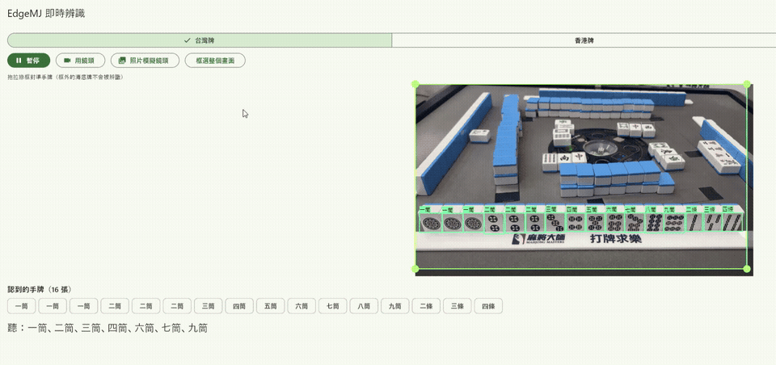
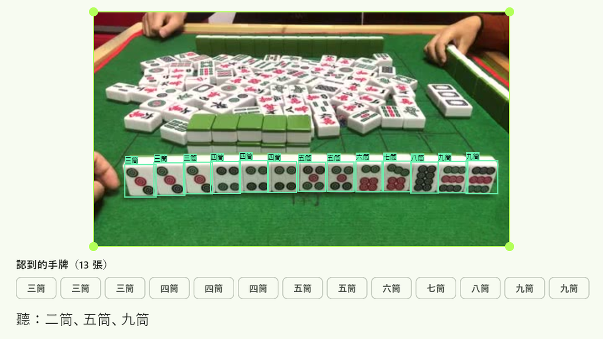
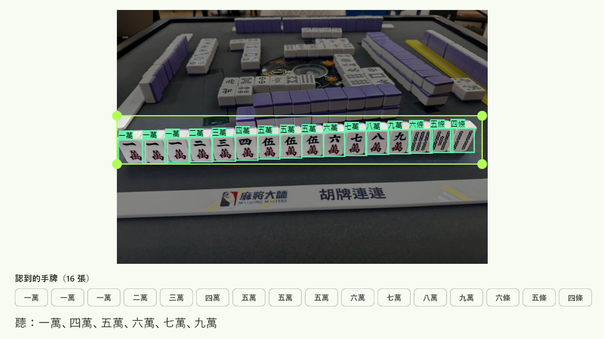

# EdgeMJ — 麻將聽牌辨識 App

**拍一張手牌，馬上知道聽哪幾張。** 完全離線的 AI 認牌工具，照片不會上傳到任何伺服器。

Flutter + YOLOv8n + TFLite｜個人作品（2026/11～進行中）



> 拖拉綠框對準手牌，框外的海底牌不會被辨識；框住的牌一變，聽牌結果馬上跟著更新。張數不對時會跳出「相公」提醒。

---

## 成果一覽

| 台灣牌辨識準確率 | 可辨識牌種 | 支援規則 | 即時辨識速度 |
|:---:|:---:|:---:|:---:|
| **99.5%**<br>（補訓練前 86.8%） | **42 類**<br>萬筒條、字牌、8 張花牌 | **3 種**<br>台灣 16 張、香港、日本 13 張 | **每秒 4～5 次**<br>（Windows 版實測） |

| 13 張筒子 → 聽二、五、九筒 | 16 張台灣牌 → 聽一、四、五、六、七、九萬 |
|:---:|:---:|
|  |  |

## 功能

- **即時辨識**：鏡頭對準手牌，自動認牌並算出聽牌
- **拍照辨識**：從照片辨識
- **手動輸入**：不用拍照，直接點選手牌
- **規則切換**：台灣牌（16 張）、香港牌、日本牌（含七對子、十三么）

## 運作流程

```
取得畫面 → 前處理（縮成 640×640）→ YOLOv8n 認牌 → 過濾海底牌與重複框 → 計算聽牌
```

全部在裝置上完成，不需要網路。

| 部分 | 技術 | 為什麼這樣選 |
|------|------|--------------|
| App | Flutter（Dart） | 同一套程式可做 iPhone、Android、Windows 版 |
| 認牌模型 | YOLOv8n | 一張照片可同時找出多張牌；選最小的 n 版，手機才跑得動 |
| 放進手機 | TFLite（float16） | 檔案小、完全離線 |
| 模型訓練 | Python、Ultralytics、NVIDIA GPU | 在 Windows 電腦上訓練 |

## 開發重點

### 1. 用台灣牌補訓練：86.8% → 99.5%

公開資料集（3,297 張訓練、449 張驗證）多半不是台灣牌，第一版模型對台灣牌只有 86.8%。
於是自己拍照，先用舊模型自動標註、再人工修正，補訓練兩次：

| 測試項目 | 補訓練前 | 補訓練後 |
|----------|:-------:|:-------:|
| 台灣牌測試 | 86.8% | **99.5%** |
| 新照片測試 | 87.3% | **93.0%** |
| 原本的大資料集（mAP50） | 0.972 | **0.978** |

第三項沒有下降，代表學了台灣牌之後，原本會的也沒有忘掉。

### 2. 從整桌牌裡分出手牌

| 問題 | 解法 |
|------|------|
| 海底牌被認進來 | 用框的大小與「是否同一排」過濾；取中位數，不會被大量海底牌拉偏 |
| 一張牌被認成兩張 | 同一位置只留一個框，並標成「需確認」 |
| 認錯了自己不知道 | 張數不符合 3n+1 時跳出「相公」提醒，交給使用者確認 |
| 即時結果一直跳動 | 連續兩輪結果相同才更新畫面 |

### 3. 聽牌計算

把手牌換成 34 種牌的計數表，逐一「假設摸進來」，檢查能否湊成「n 組面子＋1 對眼」。
拆面子時每次只看最小的那張牌（它一定是刻子或順子的開頭），所以不漏、不重複。
演算法為純 Dart 實作，並有單元測試。

## 目前進度

- [x] 拍照辨識、手動輸入、聽牌計算
- [x] 補訓練兩次，台灣牌準確率 99.5%
- [x] 手牌過濾、相公提醒
- [x] Windows 桌面版可執行
- [ ] 即時辨識手機實測
- [ ] iPhone 版（需 Mac 編譯）與上架 App Store

---

## 開發者說明

### 執行方式

1. 安裝 Flutter：https://docs.flutter.dev/get-started/install/windows
2. 在專案資料夾執行（補上 Android／iOS 平台資料夾，已存在的檔案不會被覆蓋）：
   ```
   flutter create . --project-name edge_mj --platforms=android,ios
   ```
3. 執行測試：`flutter test`
4. 執行 App：`flutter run`

> iOS 版需要在 Mac 上才能編譯。模型訓練說明見 [ml/README.md](ml/README.md)。

### 專案結構

```
lib/
  main.dart                     App 進入點（三個分頁）
  pages/                        即時辨識、拍照辨識、手動輸入畫面
  core/mahjong/
    tile.dart                   34 種牌的定義、簡寫解析（123m456p789s1z）
    hand_analyzer.dart          胡牌／聽牌判定
  core/vision/
    preprocess.dart             影像前處理（縮成 640×640）
    tile_detector.dart          執行 TFLite 模型
    yolo_decoder.dart           解讀 YOLO 輸出
    hand_filter.dart            過濾海底牌、重複框
assets/models/                  TFLite 模型
ml/                             資料集設定與訓練腳本（Python）
test/
  core/mahjong/                 演算法單元測試
```

### 牌的編號（也是 YOLO 類別 id）

| id | 牌 | 簡寫 |
|----|----|------|
| 0–8 | 一萬～九萬 | 1m–9m |
| 9–17 | 一筒～九筒 | 1p–9p |
| 18–26 | 一條～九條 | 1s–9s |
| 27–33 | 東南西北中發白 | 1z–7z |
| 34–41 | 春夏秋冬梅蘭菊竹 | 1f–8f |

### 使用範例

```dart
// 預設是台灣牌（16 張）
final waits = const HandAnalyzer().waitingTiles(parseTiles('1112345678999m123p'));
// → 1m ~ 9m

// 切換規則
const HandAnalyzer(MahjongRules.hongKong).waitingTiles(...);
const HandAnalyzer(MahjongRules.japanese).waitingTiles(...);
```
